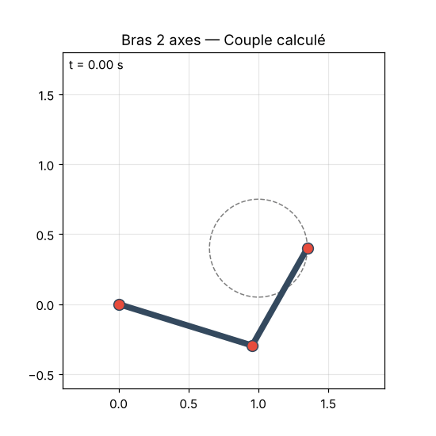
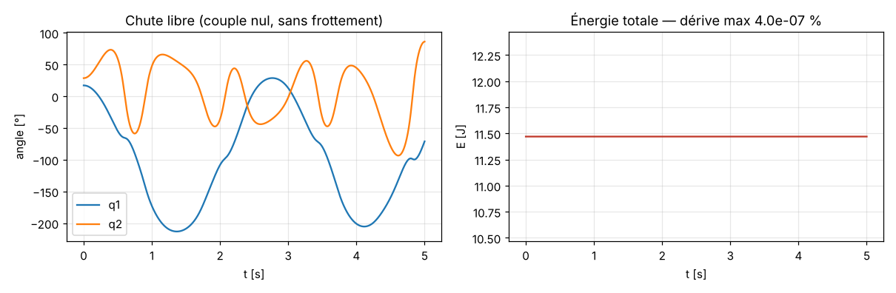
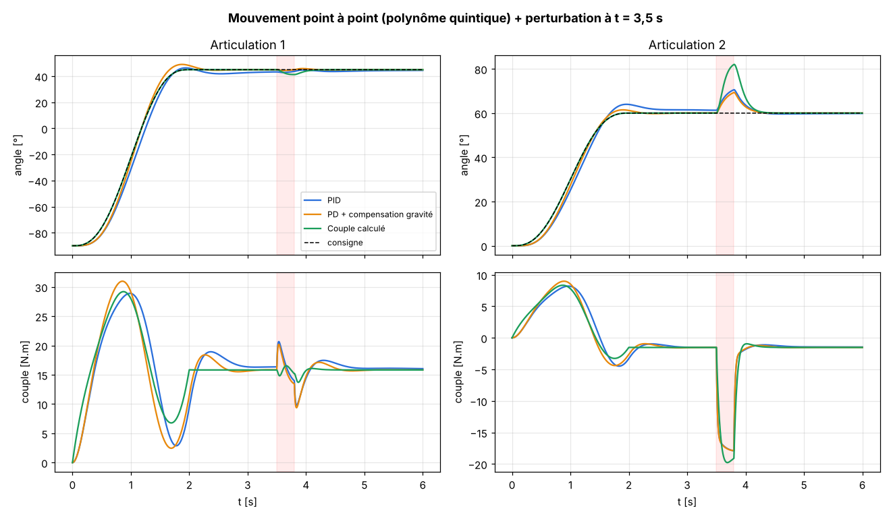
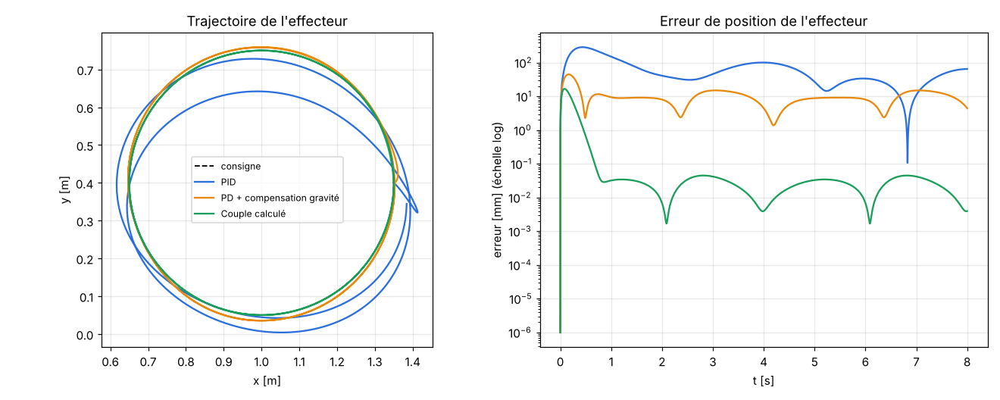

# 🦾 Commande d'un bras robotique 2 axes — modélisation & comparaison de correcteurs

Simulation complète d'un bras robotique planaire à deux articulations rotoïdes (robot **RR**) évoluant dans un plan vertical, soumis à la gravité et au frottement. Le projet couvre toute la chaîne **automatique / robotique** : modélisation, validation du modèle, génération de trajectoires et comparaison de trois lois de commande.



## Contenu

| Étape | Ce qui est fait |
|---|---|
| **Cinématique** | Modèle géométrique direct et inverse, jacobien |
| **Dynamique** | Équations de Lagrange : `M(q)·q̈ + C(q,q̇)·q̇ + G(q) + F·q̇ = τ` |
| **Validation** | Conservation de l'énergie en chute libre sans frottement |
| **Trajectoires** | Polynôme quintique (point à point) et cercle cartésien (via le jacobien) |
| **Commande** | PID, PD + compensation de gravité, couple calculé |
| **Simulation** | Intégration Runge-Kutta 4 à 1 kHz, commande échantillonnée, saturation des couples à ±60 N.m |

## Les trois correcteurs

**1. PID articulaire** — un PID indépendant par axe, sans aucune connaissance du modèle. Simple, mais la gravité et les couplages entre axes sont vus comme des perturbations.

**2. PD + compensation de gravité** — on ajoute le terme `G(q)` au PD. La stabilité asymptotique en régulation se démontre par une fonction de Lyapunov (énergie cinétique + énergie de l'erreur).

**3. Couple calculé (linéarisation par retour d'état)**

```
τ = M(q)·[q̈_ref + Kd·ė + Kp·e] + C(q,q̇)·q̇ + G(q) + F·q̇
```

Le modèle inverse annule les non-linéarités, et l'erreur suit une dynamique linéaire découplée `ë + Kd·ė + Kp·e = 0`. Les gains sont placés pour un pôle double en −12 rad/s (amortissement critique).

## Résultats

### Validation du modèle
Sans frottement ni couple, l'énergie totale reste constante (dérive < 10⁻⁶ %), ce qui valide les équations dynamiques et l'intégrateur.



### Mouvement point à point avec perturbation
Passage de (−90°, 0°) à (45°, 60°) en 2 s, puis un choc de 15 N.m sur l'axe 2 à t = 3,5 s.



### Suivi d'un cercle dans l'espace cartésien



| Correcteur | Erreur moyenne effecteur | Erreur max |
|---|---|---|
| PID | 39,5 mm | 101 mm |
| PD + compensation gravité | 8,6 mm | 15 mm |
| **Couple calculé** | **0,02 mm** | **0,05 mm** |

Tableau complet : [`results/metrics.md`](results/metrics.md)

## Analyse

- **Le modèle fait la différence en suivi** : le couple calculé est environ 2 000 fois plus précis que le PID sur le cercle, car il anticipe les couples d'inertie, de Coriolis et de gravité au lieu de les subir.
- **La compensation de gravité suffit déjà à beaucoup gagner** (÷ 5 sur l'erreur), pour un coût de calcul très faible.
- **Contrepartie du couple calculé** : face au choc, il dévie davantage (≈ 22° contre ≈ 10°). Ses gains agissent sur l'accélération et sont multipliés par l'inertie `M(q)`, petite sur l'axe 2, donc la raideur réelle de cet axe est faible. En pratique, on combine souvent le couple calculé avec une action intégrale ou une commande robuste.
- **Limites du modèle** : le couple calculé suppose un modèle parfait. Une piste naturelle est de tester sa robustesse face à des erreurs de paramètres (masse de charge inconnue, par exemple).

## Lancer le projet

```bash
git clone https://github.com/<ton-pseudo>/robot-arm-2dof.git
cd robot-arm-2dof
pip install -r requirements.txt
python src/main.py
```

Toutes les figures sont régénérées dans `results/` (environ 20 secondes).

## Structure

```
robot-arm-2dof/
├── src/
│   ├── robot.py        # cinématique + modèle dynamique
│   ├── controllers.py  # PID, PD + gravité, couple calculé
│   ├── trajectory.py   # quintique, cercle cartésien
│   ├── simulator.py    # intégration RK4 + indicateurs
│   └── main.py         # expériences et figures
├── results/            # figures, GIF, métriques
└── requirements.txt
```

## Pistes d'amélioration

- Robustesse : erreur de 20 % sur les masses, charge saisie en cours de mouvement
- Commande adaptative (Slotine-Li) pour estimer les paramètres en ligne
- Commande dans l'espace opérationnel et gestion des singularités
- Passage à un robot 3D avec la bibliothèque `roboticstoolbox-python`

## Auteur

**Ismail Drira** — Ingénieur en Génie Industriel, licence en Informatique Industrielle et Automatisme.
